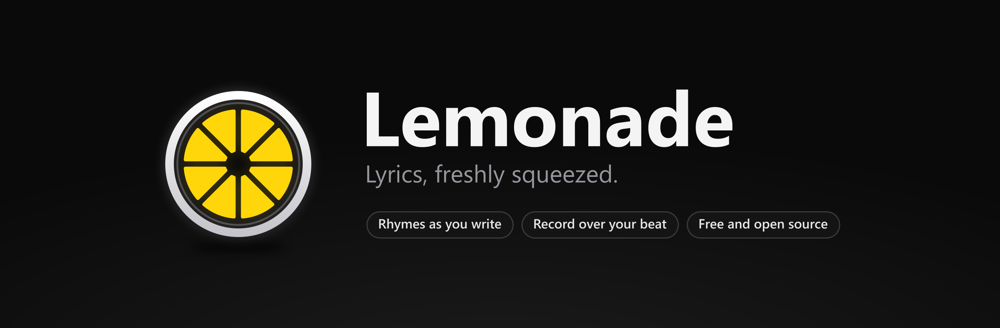

<p align="center">
  
</p>

<p align="center">
  <a href="https://github.com/slashneck/Lemonade/releases/latest"></a>
  <a href="https://github.com/slashneck/Lemonade/releases"></a>
  
  <a href="LICENSE"></a>
</p>

<p align="center">
  <a href="https://github.com/slashneck/Lemonade/releases/latest"><b>Download for Windows</b></a>
  &nbsp;&nbsp;|&nbsp;&nbsp;
  <a href="#features">Features</a>
  &nbsp;&nbsp;|&nbsp;&nbsp;
  <a href="#shortcuts">Shortcuts</a>
  &nbsp;&nbsp;|&nbsp;&nbsp;
  <a href="#building">Build it yourself</a>
</p>

<br>

Lemonade is a lyric pad for rap and hip-hop. Write your bars and the last word of every line gets rhymed on the side,
with slang and multisyllable rhymes included. Your beat plays right next to the page, takes get recorded over it, and
every song stays sorted in projects and folders on your own PC.

## Features

**Rhymes while you write.** Perfect, near, slant, multisyllable and slang rhymes for the end of the bar you're on, or for
any word you select. They come from a phonetic dictionary of about 54,000 words that works offline and hears rhymes the
way rap does: gone rhymes with on, money with body. Click a rhyme to see what it means, double-click to drop it in. Turn
on the online dictionary for extra phrases, similar words and definitions.

**A pad that knows bars.** Numbered bars per `[Verse]` and `[Hook]`, syllables per bar, the rhyme scheme letter of every
line and colored rhyme highlighting, either for line endings or for every rhyme in the song. Focus mode hides everything
else.

**Spelling, your way.** Misspelled words get a red line, checked offline against about 280,000 words plus all the slang.
Choose Off to only see the line, Suggest to get fixes when you point at a word, or Auto to have words fixed as you
finish them. Ctrl+Z puts your word back, and anything you add to your dictionary stays put.

**A word library.** Close to 500 slang and hip-hop terms with a short meaning each, sorted into money, style, street,
craft and more. Add your own words, with a "rhymes with" hint so the rhymes come out right.

**Your beat, next to the page.** Import audio files or drop them on the window, or save YouTube and SoundCloud links that
play in a small player inside the app. The waveform player loops a section with A-B, finds the BPM by itself and has a
tap tempo. Attach a beat to a song and Lemonade tells you how long the song runs at that tempo. The metronome locks to
the beat's grid, so it starts, stops and loops together with it.

**Record takes.** Record yourself over the beat and play the takes back in sync with it. Pick your mic, boost a quiet
one, watch the level meter and count in a bar before you start. Export a take as WAV, the vocal alone or mixed with the
beat.

**Perform mode.** A full screen teleprompter that moves from bar to bar in time with the beat or the metronome, with a
count-in. The metronome is a soft classic click with an accented first beat.

**Never lose a line.** Lyrics save as you type. Lemonade keeps versions of every song while you write, and you can see
what changed and restore any of them. Each song also has a notes pad and a word bank for punchlines you want to keep.

**Projects, folders, archive.** Sort songs with drag and drop, search across every lyric, archive what you're done with
and export to text or PDF. Drop text files on the window to turn them into lyrics, and save a whole project back as text
files with one click. Dark or light, with the accent color of your choice.

## Install

Download `LemonadeSetup` from the [latest release](https://github.com/slashneck/Lemonade/releases/latest) and run it.
It installs for your Windows account only, so no admin rights are needed, and it keeps itself up to date.

The setup isn't code signed yet, so Windows SmartScreen may say it "protected your PC". Click **More info** and then
**Run anyway**. Every release lists the SHA-256 checksum of its files.

You need Windows 10 (version 1903 or newer) or Windows 11, 64 bit.

## Shortcuts

| Action | Keys |
| --- | --- |
| New lyric | <kbd>Ctrl</kbd> + <kbd>N</kbd> |
| Look up a word | <kbd>Ctrl</kbd> + <kbd>K</kbd> |
| Play or pause the beat | <kbd>Ctrl</kbd> + <kbd>Space</kbd> |
| Record a take | <kbd>Ctrl</kbd> + <kbd>R</kbd> |
| Perform mode | <kbd>Ctrl</kbd> + <kbd>P</kbd> |
| Metronome on or off | <kbd>Ctrl</kbd> + <kbd>M</kbd> |
| Focus mode | <kbd>Ctrl</kbd> + <kbd>Shift</kbd> + <kbd>F</kbd> |
| Search lyrics | <kbd>Ctrl</kbd> + <kbd>F</kbd> |
| Export | <kbd>Ctrl</kbd> + <kbd>E</kbd> |
| Hide the library or the side panel | <kbd>Ctrl</kbd> + <kbd>B</kbd>, <kbd>Ctrl</kbd> + <kbd>J</kbd> |
| Close whatever is on top | <kbd>Esc</kbd> |

## Where your files are

| What | Where |
| --- | --- |
| Lyrics, settings, imported beats and takes | `%AppData%\Lemonade` |
| The program | `%LocalAppData%\Programs\Lemonade` |

Updates only replace program files. Uninstalling removes the program and leaves your lyrics, beats and takes where they
are. Settings, Library, Backup exports all lyrics and beat links to one file.

## Privacy

Your lyrics, beats and recordings stay on your PC. There is no account, no telemetry and no upload. Lemonade only goes
online for three things, each of which you can avoid:

- The **online dictionary** sends the words you look up to the Datamuse API. Switch it off under Settings, Rhymes and
  dictionary, and rhymes keep working offline.
- **Beat links** load the YouTube or SoundCloud player when you play them.
- The **update check** asks GitHub whether a new version exists. Switch it off under Settings, Updates.

## Building

You need Node.js 20 or newer and the .NET 8 SDK.

```powershell
.\build-release.ps1
```

The script installs the packages, builds the word list and the art, packs Lemonade and writes the setup, the update zip
with its checksum and a source zip to `dist`. For development, run `npm install`, `npm run lexicon` and then `npm start`.

## License

Copyright (C) 2026 slashneck. Lemonade is free software under the [GNU General Public License version 3](LICENSE): you
can use, change and share it, and any version you share has to stay under the same license with its source code
available. The license doesn't cover the Lemonade name or logo (GPLv3 section 7e), so please give modified versions
their own name.

Lemonade is built on Electron and uses word data from the CMU Pronouncing Dictionary, SUBTLEX-US and
an-array-of-english-words. See [THIRD-PARTY-NOTICES.md](THIRD-PARTY-NOTICES.md).
